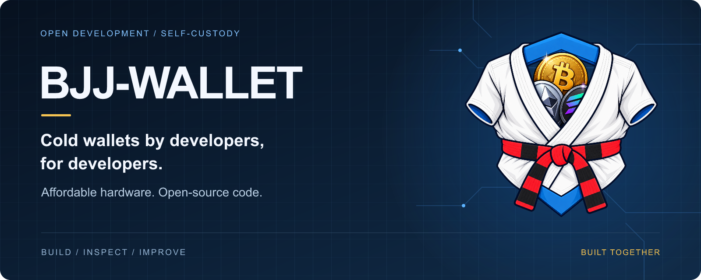
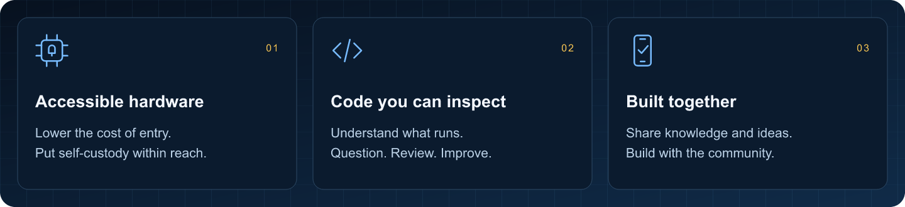

<picture>
  <source media="(max-width: 640px)" srcset="./assets/hero-mobile.png">
  
</picture>

 

  
  
  

<h3 align="center">Self-custody should be within everyone’s reach.</h3>

  We’re developers working to make cold wallets affordable, functional, and secure. 
  Built by developers, for developers. Open to everyone.

  <a href="https://github.com/bjjwallet?tab=repositories"><strong>Explore our work ↗</strong></a>
  &nbsp; · &nbsp;
  <a href="#build-with-us"><strong>Build with us ↓</strong></a>

## 👋 We are BJJ-Wallet

We’re a group of developers who believe that taking control of your crypto should be more accessible — and that you should be able to understand what runs on your wallet.

Our mission is to **bring cold wallets to more people through affordable hardware, open-source software, and shared knowledge.** We want to make building, using, and improving these tools easier for everyone.

## 🧭 What drives us

<picture>
  <source media="(max-width: 640px)" srcset="./assets/values-mobile.png">
  
</picture>

- **🔧 Accessibility:** Lower the cost of entry and make cold wallets practical for more people.
- **🔍 Transparency:** Let people inspect the code, understand the decisions, and question how things work.
- **🛡️ Careful security engineering:** Build security through thoughtful design, testing, and open review.
- **🤝 Collaboration:** Share what we learn and improve through the experience of others.

## 🌱 Help us build something better

Developers, makers, designers, testers, and curious minds: you’re welcome here.

Read our code. Try our ideas. Challenge our assumptions. Share a bug, improve a translation, suggest a better design, or help someone understand how it works. Every useful contribution helps move the project forward.

**Together, we can make self-custody more accessible, transparent, and understandable.**

   
  <a href="https://github.com/bjjwallet?tab=repositories"><strong>Discover our projects →</strong></a> 
  BJJ-Wallet · Built by developers. Open to everyone.

